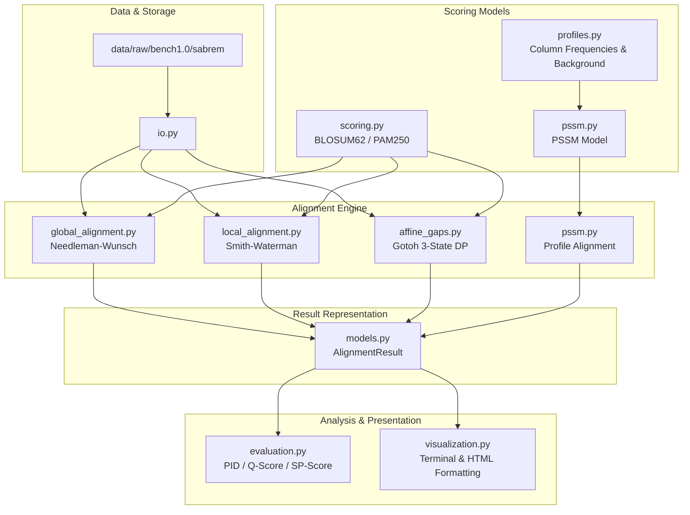

# ProteinAlign Lab — Software Architecture and Package Design

This document details the modular software design, package architecture, component contracts, type specifications, and interface standards for the `proteinalign` toolkit.

---

## 1. Modular Architecture Overview

The toolkit separates algorithmic logic, mathematical representations, data IO, and downstream evaluation into independent, decoupled layers:



---

## 2. Directory Layout and Separation of Concerns

```text
ProteinAlign-Lab/
├── data/
│   └── raw/
│       └── bench1.0/sabrem/ref/    # Immutable reference benchmark (MUSTANG SABRE)
├── docs/
│   ├── mathematics.md              # Mathematical models, recurrences, and proofs
│   ├── methodology.md              # Experimental design, leakage prevention, splitting
│   ├── architecture.md             # Software architecture and module contracts
│   ├── testing.md                  # Test strategy, validation, invariants
│   └── phase3_plan.md              # Phase 3 tasks, acceptance criteria, milestones
├── report/
│   ├── dataset_summary.md          # Dataset statistics
│   └── dataset_inspection_report.md# Formal provenance and data audit report
├── src/
│   └── proteinalign/               # Reusable, installable library
│       ├── __init__.py             # Public API entrypoint
│       ├── models.py               # AlignmentResult dataclass
│       ├── scoring.py              # SubstitutionMatrix, BLOSUM62, PAM250
│       ├── profiles.py             # Frequency profiles and pseudocount priors
│       ├── pssm.py                 # PSSM class and profile-sequence alignment
│       ├── global_alignment.py     # Needleman-Wunsch algorithm
│       ├── local_alignment.py      # Smith-Waterman algorithm
│       ├── affine_gaps.py          # Gotoh affine gap DP
│       ├── io.py                   # FASTA and MSA parsers
│       ├── evaluation.py           # Benchmark scoring (PID, Q-score, SP-score)
│       └── visualization.py        # Terminal formatting and HTML rendering
├── tests/
│   ├── __init__.py
│   ├── test_alignment.py           # Manually verifiable unit and property tests
│   ├── test_edge_cases.py          # Empty inputs, length discrepancies, exceptions
│   └── test_biopython_compat.py    # Independent cross-validation with Biopython
├── pyproject.toml                  # PEP 517/621 packaging metadata
├── requirements.txt                # Production and testing dependencies
├── LICENSE                         # MIT Open Source License
└── README.md                       # Overview and quick-start guide
```

---

## 3. Module Responsibilities and Function Signatures

### 3.1 `models.py`
Encapsulates alignment outputs in a frozen, immutable data structure:
```python
@dataclass(frozen=True)
class AlignmentResult:
    seq1_aligned: str
    seq2_aligned: str
    score: float
    start1: int
    end1: int
    start2: int
    end2: int
    alignment_type: str  # 'global', 'local', 'affine_global', 'affine_local', 'pssm_global'
    gap_open: float
    gap_extend: float
    matrix_name: str

    @property
    def length(self) -> int: ...
    @property
    def identity(self) -> float: ...
    @property
    def similarity(self) -> float: ...
```

### 3.2 `scoring.py`
Provides substitution matrix storage, case-insensitivity, and preloaded BLOSUM62 and PAM250 matrices:
```python
class SubstitutionMatrix:
    def __init__(self, matrix_dict: Dict[Tuple[str, str], float], name: str = "custom", default_score: float = -4.0) -> None: ...
    def score(self, a: str, b: str) -> float: ...
    @classmethod
    def load_blosum62(cls) -> "SubstitutionMatrix": ...
    @classmethod
    def load_pam250(cls) -> "SubstitutionMatrix": ...
    @classmethod
    def create_identity(cls, match: float = 2.0, mismatch: float = -1.0) -> "SubstitutionMatrix": ...
```

### 3.3 `profiles.py`
Handles column transposition, amino acid counts, and Dirichlet/pseudocount regularization:
```python
def extract_alignment_columns(sequences: Sequence[str]) -> List[List[str]]: ...
def compute_column_counts(columns: List[List[str]]) -> List[Dict[str, int]]: ...
def compute_profile_frequencies(counts: List[Dict[str, int]], pseudocount_weight: float = 1.0, background: Optional[Dict[str, float]] = None) -> List[Dict[str, float]]: ...
```

### 3.4 `pssm.py`
Constructs PSSMs from multiple sequence alignments and executes profile-sequence alignments:
```python
class PSSM:
    def __init__(self, matrix: List[Dict[str, float]], name: str = "pssm", consensus: str = "", background: Optional[Dict[str, float]] = None) -> None: ...
    def score(self, pos: int, residue: str) -> float: ...
    @classmethod
    def from_msa(cls, aligned_sequences: Sequence[str], name: str = "profile", pseudocount_weight: float = 1.0, background: Optional[Dict[str, float]] = None, scale: float = 2.0) -> "PSSM": ...
    def align_sequence_global(self, query: str, gap_penalty: float = 8.0) -> AlignmentResult: ...
```

### 3.5 `global_alignment.py`
Implements Needleman–Wunsch with linear gap penalties:
```python
def needleman_wunsch(seq1: str, seq2: str, matrix: Optional[SubstitutionMatrix] = None, gap_penalty: float = 8.0) -> AlignmentResult: ...
```

### 3.6 `local_alignment.py`
Implements Smith–Waterman with linear gap penalties:
```python
def smith_waterman(seq1: str, seq2: str, matrix: Optional[SubstitutionMatrix] = None, gap_penalty: float = 8.0) -> AlignmentResult: ...
```

### 3.7 `affine_gaps.py`
Implements Gotoh's three-state dynamic programming for affine gaps:
```python
def needleman_wunsch_affine(seq1: str, seq2: str, matrix: Optional[SubstitutionMatrix] = None, gap_open: float = 10.0, gap_extend: float = 1.0) -> AlignmentResult: ...
def smith_waterman_affine(seq1: str, seq2: str, matrix: Optional[SubstitutionMatrix] = None, gap_open: float = 10.0, gap_extend: float = 1.0) -> AlignmentResult: ...
```

### 3.8 `io.py`
FASTA and multiple alignment parsing with strict integrity validation:
```python
def read_fasta(filepath: Union[str, Path]) -> List[Tuple[str, str]]: ...
def write_fasta(records: List[Tuple[str, str]], filepath: Union[str, Path], line_width: int = 60) -> None: ...
def read_msa(filepath: Union[str, Path]) -> Dict[str, str]: ...
```

### 3.9 `evaluation.py`
Calculates benchmark metrics:
```python
def compute_pid(aligned1: str, aligned2: str, mode: str = "aligned_columns") -> float: ...
def compute_q_score(test_alignment: Dict[str, str], ref_alignment: Dict[str, str], uppercase_only: bool = True) -> float: ...
def compute_sp_score(alignment: Dict[str, str], matrix: Optional[SubstitutionMatrix] = None, gap_penalty: float = 8.0) -> float: ...
```

### 3.10 `visualization.py`
Renders alignments for console and reports:
```python
def format_alignment(result: AlignmentResult, line_width: int = 60) -> str: ...
def alignment_to_html(result: AlignmentResult) -> str: ...
```
