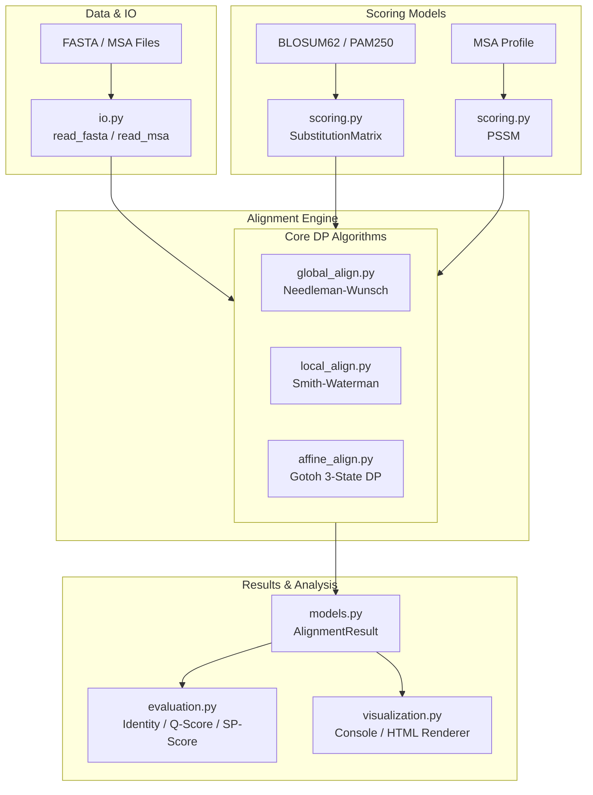

# Software Architecture & Design Specification

## 1. System Architecture Overview



---

## 2. Project Directory Structure

```text
ProteinAlign-Lab/
├── data/
│   └── raw/
│       ├── bench.tar.gz
│       └── bench1.0/
│           ├── bali3/
│           ├── ox/
│           ├── prefab4/
│           └── sabrem/
├── docs/
│   ├── mathematics.md
│   └── design.md
├── notebooks/
├── src/
│   └── proteinalign/
│       ├── __init__.py
│       ├── models.py
│       ├── scoring.py
│       ├── global_align.py
│       ├── local_align.py
│       ├── affine_align.py
│       ├── io.py
│       ├── evaluation.py
│       └── visualization.py
├── tests/
│   ├── __init__.py
│   └── test_alignment.py
├── experiments/
├── report/
│   └── dataset_summary.md
├── inspect_dataset.py
├── inspect_one_file.py
├── summarize_dataset.py
├── pyproject.toml
├── requirements.txt
└── .gitignore
```

---

## 3. Core Data Structures & Interfaces (`models.py`)

```python
from dataclasses import dataclass
from typing import Optional, List, Dict, Tuple

@dataclass(frozen=True)
class AlignmentResult:
    """Encapsulates the complete output of a pairwise sequence alignment."""
    seq1_aligned: str
    seq2_aligned: str
    score: float
    start1: int
    end1: int
    start2: int
    end2: int
    alignment_type: str  # "global", "local", "affine_global", "affine_local"
    gap_open: float
    gap_extend: float
    matrix_name: str

    @property
    def length(self) -> int:
        return len(self.seq1_aligned)

    @property
    def identity(self) -> float:
        """Percentage of identical aligned residue pairs."""
        matches = sum(1 for a, b in zip(self.seq1_aligned, self.seq2_aligned) if a == b and a != "-")
        return (matches / self.length) * 100.0 if self.length > 0 else 0.0
```

---

## 4. Module Function Signatures

### 4.1 Scoring Module (`scoring.py`)
```python
class SubstitutionMatrix:
    """Log-odds substitution matrix (e.g. BLOSUM62, PAM250)."""
    def __init__(self, matrix_dict: Dict[Tuple[str, str], float], name: str = "custom") -> None: ...
    def score(self, a: str, b: str) -> float: ...
    @classmethod
    def load_blosum62(cls) -> "SubstitutionMatrix": ...
    @classmethod
    def load_pam250(cls) -> "SubstitutionMatrix": ...
    @classmethod
    def create_identity(cls, match: float = 2.0, mismatch: float = -1.0) -> "SubstitutionMatrix": ...

class PSSM:
    """Position-Specific Scoring Matrix constructed from an MSA or profile."""
    def __init__(self, matrix: List[Dict[str, float]], name: str = "pssm") -> None: ...
    def score(self, pos: int, residue: str) -> float: ...
    @classmethod
    def from_sequences(cls, sequences: List[str], pseudocount: float = 1.0) -> "PSSM": ...
```

### 4.2 Global Alignment (`global_align.py`)
```python
def needleman_wunsch(
    seq1: str,
    seq2: str,
    matrix: Optional[SubstitutionMatrix] = None,
    gap_penalty: float = 8.0,
) -> AlignmentResult:
    """Computes optimal global pairwise sequence alignment via Needleman-Wunsch with linear gap penalty."""
    ...
```

### 4.3 Local Alignment (`local_align.py`)
```python
def smith_waterman(
    seq1: str,
    seq2: str,
    matrix: Optional[SubstitutionMatrix] = None,
    gap_penalty: float = 8.0,
) -> AlignmentResult:
    """Computes optimal local pairwise sequence alignment via Smith-Waterman with linear gap penalty."""
    ...
```

### 4.4 Affine Gap Alignment (`affine_align.py`)
```python
def needleman_wunsch_affine(
    seq1: str,
    seq2: str,
    matrix: Optional[SubstitutionMatrix] = None,
    gap_open: float = 10.0,
    gap_extend: float = 1.0,
) -> AlignmentResult:
    """Computes optimal global alignment with affine gap penalty via Gotoh 3-state DP."""
    ...

def smith_waterman_affine(
    seq1: str,
    seq2: str,
    matrix: Optional[SubstitutionMatrix] = None,
    gap_open: float = 10.0,
    gap_extend: float = 1.0,
) -> AlignmentResult:
    """Computes optimal local alignment with affine gap penalty via 3-state DP."""
    ...
```

### 4.5 Input / Output Module (`io.py`)
```python
def read_fasta(filepath: Union[str, Path]) -> List[Tuple[str, str]]:
    """Parses a FASTA file into a list of (header, sequence) tuples."""
    ...

def write_fasta(records: List[Tuple[str, str]], filepath: Union[str, Path]) -> None:
    """Writes (header, sequence) records to a FASTA file."""
    ...

def read_msa(filepath: Union[str, Path]) -> Dict[str, str]:
    """Reads a Multiple Sequence Alignment file, preserving aligned gaps."""
    ...
```

### 4.6 Evaluation Module (`evaluation.py`)
```python
def compute_pid(aligned1: str, aligned2: str) -> float:
    """Calculates percent sequence identity between two aligned sequences."""
    ...

def compute_q_score(test_alignment: Dict[str, str], ref_alignment: Dict[str, str]) -> float:
    """Computes the benchmark Q-score (developer score) against reference alignment."""
    ...

def compute_sp_score(alignment: Dict[str, str], matrix: Optional[SubstitutionMatrix] = None) -> float:
    """Computes the Sum-of-Pairs (SP) score across all sequence pairs in an MSA."""
    ...
```

### 4.7 Visualization Module (`visualization.py`)
```python
def format_alignment(result: AlignmentResult, line_width: int = 60) -> str:
    """Formats an alignment for terminal or text display with match/mismatch markers."""
    ...

def alignment_to_html(result: AlignmentResult) -> str:
    """Renders alignment as color-coded HTML with residue biochemical styling."""
    ...
```
