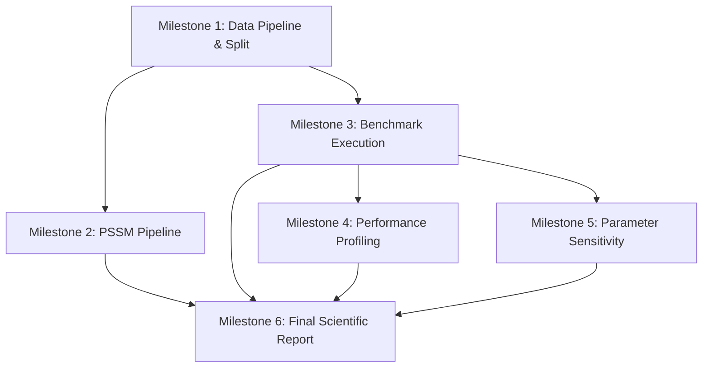

# ProteinAlign Lab — Phase 3 Implementation and Experimentation Plan

This document defines the tasks, dependencies, milestones, and acceptance criteria for **Phase 3: Implementation, Benchmarking, and Empirical Evaluation**.

---

## 1. Phase 3 Objectives
1. Implement the benchmark experimental pipeline converting the 303 SABRE multiple sequence alignments into pairwise evaluation pairs.
2. Execute systematic comparative alignments across the five experimental dimensions defined in Phase 2.
3. Compute benchmark accuracy metrics ($Q$-score, Modeler score, and Sum-of-Pairs score).
4. Conduct empirical complexity profiling (runtime $\mathcal{O}(m \cdot n)$ scaling and heap memory usage via `tracemalloc`).
5. Run parameter-sensitivity grid searches for gap opening and extension penalties.
6. Generate publication-quality figures and a comprehensive scientific report.

---

## 2. Task Breakdown and Milestones

### Milestone 1: Data Pipeline and Pairwise Extraction
- **Task 1.1**: Build `experiments/prepare_dataset.py` to parse all 303 files in `data/raw/bench1.0/sabrem/ref/`.
- **Task 1.2**: Extract all unique sequence pairs $\binom{K}{2}$ per file, strip gaps to generate raw inputs, and preserve core-conserved uppercase column mappings.
- **Task 1.3**: Partition the 303 families into reproducible Train (60%), Validation (20%), and Test (20%) splits using `seed=42`.
- *Acceptance Criteria*: Fully reproducible `data/processed/pairwise_dataset.json` containing pairs, split labels, and core reference mappings.

### Milestone 2: PSSM and Profile-Sequence Pipeline
- **Task 2.1**: Implement leave-one-out (LOO) PSSM builder in `experiments/run_pssm_benchmark.py`.
- **Task 2.2**: Ensure strict query sequence exclusion and $\ge 90\%$ sequence identity filtering to prevent data leakage.
- **Task 2.3**: Align queries against family PSSMs and evaluate accuracy.
- *Acceptance Criteria*: Zero data leakage verified; query excluded from PSSM profile during every test evaluation.

### Milestone 3: Benchmark Execution & Accuracy Evaluation
- **Task 3.1**: Run pairwise global alignment (Needleman–Wunsch) with BLOSUM62 and PAM250 under linear gap penalties.
- **Task 3.2**: Run pairwise Gotoh affine alignment with BLOSUM62 and PAM250 ($d=10, e=1$).
- **Task 3.3**: Run local alignment (Smith–Waterman) on domain-divergent pairs.
- **Task 3.4**: Compute $Q$-score (developer score on uppercase core columns) and PID for all experimental conditions.
- *Acceptance Criteria*: CSV table of results containing $Q$-scores across all sequence pairs and algorithm combinations.

### Milestone 4: Performance and Complexity Profiling
- **Task 4.1**: Measure wall-clock runtimes using `time.perf_counter_ns` across sequence lengths $L \in [50, 1000]$.
- **Task 4.2**: Measure peak memory allocations using `tracemalloc`.
- **Task 4.3**: Fit empirical runtime against sequence length product $m \cdot n$ and verify quadratic $\mathcal{O}(m \cdot n)$ scaling.
- *Acceptance Criteria*: Runtime and memory curves plotted and saved in `report/figures/`.

### Milestone 5: Parameter Sensitivity Analysis
- **Task 5.1**: Grid search gap opening penalty $d \in [6.0, 16.0]$ in increments of 2.0.
- **Task 5.2**: Grid search gap extension penalty $e \in [0.5, 3.0]$ in increments of 0.5.
- **Task 5.3**: Generate 2D heatmaps showing $Q$-score sensitivity surfaces stratified by sequence identity tiers ($<20\%$, $20-40\%$, $>40\%$).
- *Acceptance Criteria*: Sensitivity surface heatmaps generated and optimal parameter pairs identified.

### Milestone 6: Final Report and Synthesis
- **Task 6.1**: Synthesize all empirical findings into `report/final_report.md`.
- **Task 6.2**: Provide actionable bioinformatics recommendations on matrix and penalty choices.
- *Acceptance Criteria*: Complete scientific report with methodology, results tables, discussion, and conclusions.

---

## 3. Dependency Graph

